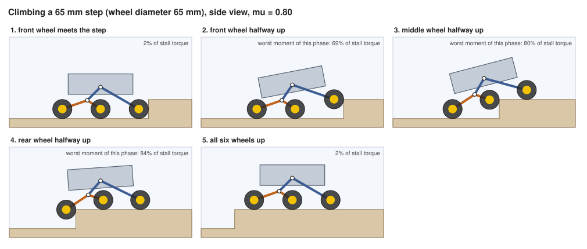

# Rocker-Bogie Rover

A six-wheel rover designed around a PETG rocker-bogie suspension, 65 mm wheels, and six TT gear motors. The project supports laptop-based manual control and onboard waypoint navigation with ultrasonic obstacle avoidance. The suspension design targets a 65 mm step.

Both firmware targets build in [CI](.github/workflows/build.yml), which also starts the ROS 2 simulator headless. Physical testing is pending.

## Mechanical design

[SolidWorks assembly](hardware/cad/Rover_Assembly.step.SLDASM) for the rover's 3D-printable rocker-bogie suspension. Open the assembly in SolidWorks to inspect the design.

## System architecture

| Component | Role |
| --- | --- |
| [STM32F411 firmware](firmware/stm32_body) | Runs the 100 Hz motor and steering loop, reads the HC-SR04, and handles close-range forward stops and drive-command timeouts. |
| [ESP32 firmware](firmware/esp32_brain) | Runs waypoint following and obstacle avoidance. Exchanges commands and telemetry with the STM32 at 20 Hz over 115200-baud UART and connects to the laptop via micro-ROS over Wi-Fi. |
| [ROS 2 laptop tools](ros2_ws/src/rover_station) | Provide keyboard control, YAML mission uploads, and the odometry transform for RViz. |
| [Shared C++17 control code](ros2_ws/src/rover_core) | Implements the UART protocol, wheel and steering kinematics, command-based odometry, and navigation. The firmware and the [software-in-the-loop node](ros2_ws/src/rover_sil) use these same controllers. |
| [Python simulator](ros2_ws/src/rover_sim) | Models the drivetrain, suspension, terrain contact, and ultrasonic sensor. Includes a standalone step-climb analysis. |

## Run the simulator

Use Ubuntu 24.04 with [ROS 2 Jazzy](https://docs.ros.org/en/jazzy/Installation.html). With `rosdep` initialized, run the following from the repository root.

```bash
source /opt/ros/jazzy/setup.bash
cd ros2_ws
rosdep install --from-paths src --ignore-src -y
colcon build --symlink-install
source install/setup.bash
ros2 launch rover_bringup sim.launch.py
```

Open a second terminal at the repository root for keyboard control.

```bash
source /opt/ros/jazzy/setup.bash
source ros2_ws/install/setup.bash
ros2 run rover_station teleop
```

The simulator opens in RViz in manual mode. The default world includes a 65 mm curb and a taller crate. Press `g` to start the [example mission](ros2_ws/src/rover_bringup/config/missions/yard_loop.yaml). Use `rviz:=false` for a headless run or `ground_truth:=true` to feed the path follower the simulated pose instead of command-based odometry.

| Key | Action |
| --- | --- |
| `w` / `s` | Increase or decrease forward velocity. `s` can command reverse. |
| `a` / `d` | Increase left or right turn rate. |
| Space | Zero the manual drive command. |
| `c` | Toggle climb mode for manual driving. |
| `m` | Select manual mode. |
| `g` | Select autonomous mode. |
| `h` | Enter hold mode. |
| `r` | Restart the mission at its first waypoint from the current pose. |
| `q` | Exit teleop and send a hold command. |

## Waypoint missions

Set `mission:=/path/to/mission.yaml` on either launch file to load a custom route. Missions accept up to 32 waypoints in the `odom` frame. Coordinates are in metres, with positive x forward and positive y left at startup.

```yaml
name: rectangle
loop: false
waypoints:
  - [1.2, 0.0]
  - [1.2, 0.8]
  - [0.0, 0.8]
  - [0.0, 0.0]
```

The ESP32 follows the route using pure pursuit. When it detects a nearby obstacle, it pauses, turns to find a clear heading, and attempts a detour before returning to the route. RViz’s **2D Goal Pose** tool replaces the current mission with a single waypoint.

## Step-climb analysis

The quasi-static model predicts that the 1.51 kg design can clear a full-width 65 mm step with a 5 V motor supply. Under the model assumptions, the climb requires a friction coefficient of about 0.75 or higher and about 85% PWM duty. Demand peaks at 90 mN·m per motor as the rear wheels climb. The [model and results](docs/physics.md) include the geometry, force calculations, and parameter sweeps.



Reproduce the baseline model from the built ROS 2 workspace.

```bash
ros2 run rover_sim climb_analysis --quick --no-figures
```

## Hardware setup

The drivetrain uses six 1:90 TT gear motors, three MX1616 dual H-bridges, and two front steering servos. An HC-SR04 provides forward range data. See the [wiring and power diagram](docs/wiring.md) and [chassis build notes](docs/build_notes.md).

Install [PlatformIO Core](https://platformio.org/install/cli). The ESP32 build also requires `git`, `cmake`, and `python3-venv`. From `firmware/stm32_body`, use the command for your upload method.

```bash
pio run -t upload          # ST-Link
pio run -e dfu -t upload   # USB DFU with the board in its bootloader
```

From `firmware/esp32_brain`, copy the Wi-Fi configuration template. Set the 2.4 GHz network credentials and the IP address of the laptop running the micro-ROS agent before uploading.

```bash
cp include/wifi_secrets.example.h include/wifi_secrets.h
# Edit include/wifi_secrets.h before uploading.
pio run -t upload
```

Source the ROS 2 workspace, then run the hardware launch file with `micro_ros_agent` available.

```bash
ros2 launch rover_bringup rover.launch.py
```

If you run the agent in Docker on Linux, start it in a separate terminal and launch the rover with `agent:=false`.

```bash
docker run --rm -it --net=host microros/micro-ros-agent:jazzy udp4 --port 8888
```

The rover starts in hold mode. Run `ros2 run rover_station teleop` and press `m` for manual operation. The ESP32’s **BOOT** button toggles between autonomous and hold modes. After upload, the mission runs on the ESP32 and can continue if the laptop connection drops. If no mission has been uploaded since power-up, the firmware uses a built-in 1.2 m × 0.8 m route.

## ROS 2 interface

| Topic | Message type | Purpose |
| --- | --- | --- |
| `/cmd_vel` | `geometry_msgs/msg/Twist` | Manual drive command |
| `/rover/climb` | `std_msgs/msg/Bool` | Manual climb mode |
| `/rover/mode` | `std_msgs/msg/String` | `hold`, `manual`, `auto`, or `restart` |
| `/rover/waypoints` | `std_msgs/msg/Float32MultiArray` | Mission as `[id, loop, x0, y0, x1, y1, ...]` |
| `/odom` | `nav_msgs/msg/Odometry` | Estimated rover pose and twist |
| `/rover/range` | `sensor_msgs/msg/Range` | Forward ultrasonic range |
| `/rover/status` | `std_msgs/msg/String` | Mode, waypoint progress, and controller status |
| `/rover/path` | `nav_msgs/msg/Path` | Mission path published by the laptop for RViz |

## License

[MIT](LICENSE).
