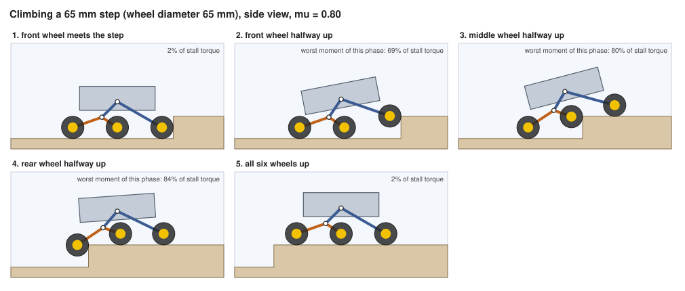
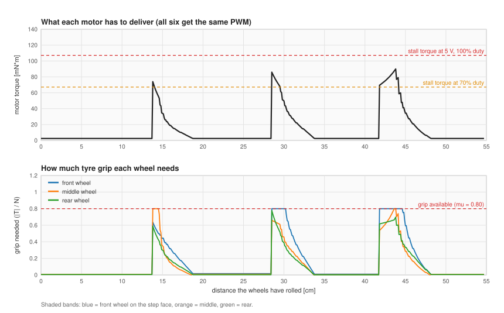
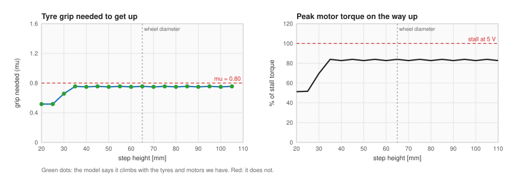
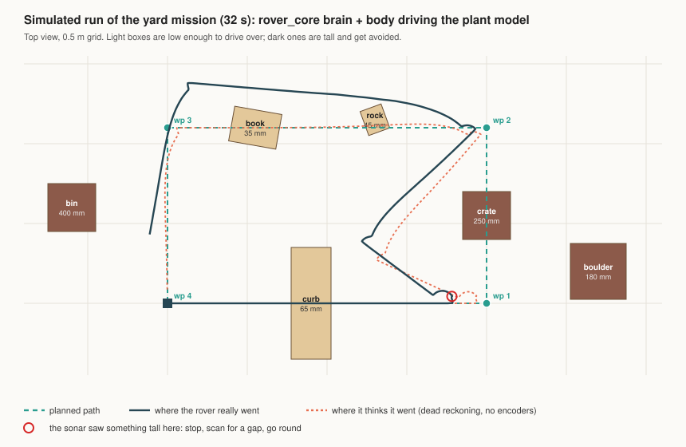

# The physics, and why the code does what it does

We wanted to know before printing anything: can six TT motors push this
thing up a step as tall as its own wheels? This page is the answer, how we
got it, and what it changed in the design.

Everything here comes from `ros2_ws/src/rover_sim`, which only needs plain
Python. To re-run it after changing the geometry:

```bash
cd ros2_ws/src/rover_sim
python3 -m rover_sim.climb_analysis            # 65 mm step, redraws docs/img/*.svg
python3 -m rover_sim.climb_analysis --height 0.08 --mu 0.6
```

## The numbers we started from

| Thing | Value | Where it comes from |
|---|---|---|
| Rover mass | 1.51 kg | sum of parts in `rover_geometry.yaml` (16 NiMH AAs are 0.42 kg of that) |
| Wheel | 65 mm diameter | Yahboom / X2 rubber TT wheel |
| Motor no-load speed | ~110 rpm at 6 V | seller spec for the 1:90 metal TT motor |
| Motor stall current | ~1.0 A at 6 V | bench measurements published for the same motor class |
| Motor stall torque | ~1.5 kgf·cm at 6 V | about twice the common 1:48 TT motor (0.8 kgf·cm) |
| Motor supply | 5.0 V | the MP2482 buck output, through the MX1616 |

From those we fit a plain DC motor model at the wheel: winding resistance
6 Ω (+0.5 Ω for the driver), back-EMF constant 0.443 V per rad/s, torque
constant 0.173 N·m/A (the gearbox losses are folded in), 0.15 A of friction.
At 5 V and 100 % duty that gives:

- stall torque **107 mN·m (1.09 kgf·cm)** per wheel
- no-load speed **9.1 rad/s, about 0.30 m/s** for the rover

These are estimates. Motors from the same bag differ by 10-20 %.

## The model

**Geometry.** Each side of a rocker-bogie is two rigid parts and a pin.
Every wheel centre has to sit on the path a 32.5 mm circle traces as it
rolls over the terrain: flat over flat ground, straight up a wall, round a
corner. Put all three wheel centres on that path, keep the two link lengths
fixed, and there's exactly one way the suspension can sit for any amount
of wheel travel. `suspension.py` solves that.

**Forces.** The rover climbs slowly, so we ignore inertia and solve for the
ground forces that keep it balanced (`statics.py`): normal force and
traction at each wheel, force and moment balance for the whole side, a
separate moment balance for the bogie (it pivots freely), and one more
assumption: every motor makes the same torque. That's what the firmware
actually does. It sends the same PWM duty to all six wheels, and identical
DC motors at the same voltage and nearly the same speed make nearly the
same torque. If a wheel would need more grip than the tyre has, it slips,
its traction is capped at μN, and the others pick up the slack.

**What it ignores.** Tyre squish, the TT motor cans hitting the step (mount
them pointing up), the step's edge crumbling, and dynamic effects. A full-
width step loads both sides equally, which is the case modelled exactly;
one-sided rocks are handled in the live simulator with the differential
averaging the two rockers.

## Result: the 65 mm step





| | |
|---|---|
| Peak motor torque | 90 mN·m = **84 % of stall** (rear wheel going up) |
| Grip needed | **μ ≥ 0.75** |
| Lowest PWM duty that makes it | **85 %** |
| Time to cross at 100 % duty | 2.2 s |
| Closest the body or an arm gets to the step | 6 mm |

So it climbs, with not much to spare. Each wheel pulls itself up the face
of the step by friction while the other two on that side push it into the
face. With equal torques the climbing wheel needs μ ≥ 0.5 from that alone,
and the load shifting around pushes it to 0.75. Dry rubber on wood or
concrete is around 0.8. Polished tile or a dusty floor won't do.

The rear wheel is the hardest. Only two wheels are left to push it, and by
then the body has tipped back onto it.

## What we changed because of it

**The bogie pin moved.** We started with the pin 40 mm above the axles,
centred between the middle and rear wheels. The model said that when the
front wheel hits the step and the bogie wheels push hard, the push at
ground level twists the bogie and lifts the middle wheel off the floor.
Moving the pin down to 30 mm above the axles and 20 mm forward fixed it.
Going lower makes the bogie arm scrape the step edge. The current values
(`bogie_pivot_x: -0.045`, `bogie_pivot_z: -0.045`) are the best of the
grid we searched.

**Climb mode.** With no encoders the STM32 can't speed up a wheel that's
bogging down; it can only set a duty. A DC motor's torque at low speed is
roughly proportional to duty, so asking for a gentle 0.1 m/s means under
50 % duty, which is far too little torque for a step. Climb mode
(`kClimbDuty = 0.95` in `params.hpp`) keeps the fastest wheel at 95 % duty
whenever the rover is moving. The rover runs at about 0.28 m/s on the flat
and slows to whatever the step allows. AUTO mode always uses it. In teleop
it's the `c` key.

**Brake, not coast.** Halfway up a step, the wheels need about 70 mN·m just
to stay put. With the MX1616 in coast mode only gearbox friction holds the
rover, and it rolls back down. In brake mode (both inputs high) the shorted
motor acts like a damper, so the rover eases back instead of rolling freely,
which gives you time to hit the key again.

## Height sweep



Above about 35 mm the requirement levels off, because the hard part is
always the same: one wheel climbing a vertical face with two pushing. The
model says it'll go up to about 105 mm before the suspension runs out of
travel. We don't trust it that far. Past ~80 mm the motor housings and the
front of the body get close enough to the edge that small build errors
decide it. In AUTO the sonar will steer around anything over ~90 mm anyway.

## What moves the needle

| Change (65 mm step) | Peak torque | Lowest duty | Result |
|---|---|---|---|
| As designed | 84 % | 85 % | climbs |
| One 8×AA pack instead of two (−0.21 kg) | 72 % | 78 % | climbs |
| Motors on 6 V instead of 5 V | 67 % | 70 % | climbs |
| Slippery floor, μ = 0.6 | – | – | **stuck** |
| Grippy surface, μ = 1.0 | 81 % | 83 % | climbs |
| Centre of mass 1 cm forward | – | 81 % | climbs (μ ≥ 0.72) |
| Centre of mass 1 cm back | – | 88 % | climbs (μ ≥ 0.80) |
| Centre of mass 2 cm forward | – | – | **stuck**, middle wheel lifts |
| Centre of mass 2 cm back | – | – | **stuck**, slips |

The centre-of-mass rows surprised us. Keep the batteries balanced so the
centre of mass is within a centimetre of the rocker pivot line; a hair
forward is best.

## Why the sonar is tilted up

The HC-SR04 sits about 13 cm off the ground, tilted 10° up, and its beam is
roughly ±15° wide. So the bottom edge of the beam points 5° down. Something
65 mm tall is under the beam once it's closer than about 0.75 m, and the
avoidance only kicks in at 0.45 m. The rover therefore never "sees" a rock
it can climb when it matters, and drives over it, like Curiosity does with
small rocks. Something 120 mm tall stays in the beam down to about 15 cm, so
the rover stops and goes around.

The simulator models the beam as a cone of rays and only counts echoes from
surfaces hit within ~50° of face-on. Ultrasound reflects like light off a
mirror, so a floor or wall at a grazing angle sends the ping away. That
means the sonar won't see the floor when the nose dips going down a step.
It also means the sonar can miss a wall it approaches at a shallow angle.

## The live simulator

`rover_sim/plant.py` reuses the same suspension and force code at 50 Hz:

- each side of the rover is solved along its own wheel track, and the
  differential bar averages the two rocker angles into the body pitch
- each wheel's speed comes from the motor model under the load the
  suspension puts on it, so climbs slow the rover down and a duty that's
  too low stalls it, just like in the table above
- wheels that would need more grip than the tyre has spin without pushing
- the body can't pass through boxes; the suspension can't bend past its
  stops or tip back more than 40°

The brain and the body controller aren't simulated: `rover_sil` runs the
real `rover_core` code (the same headers the ESP32 and STM32 compile) and
passes every command through the real UART frame encoder.



The orange dashed line is where the rover thinks it is. By the end it's
off by about 35 cm, because the odometry is dead reckoning from commanded
wheel speeds. The rover slowed down on the curb without knowing it, and
every small heading error after that grows into a position error.

## Honest limitations

- **No encoders.** The rover can't tell if it's stuck, slipping or slowed by
  a climb. The odometry drifts, and AUTO uses a time budget per leg to notice
  something went wrong. The dual-shaft TT motors make this easy to fix: put a
  slotted disc on the back shaft and an optical sensor (or a small magnetic
  encoder) on two of the middle wheels, and most of this page's caveats go
  away.
- **One narrow sonar.** It can't see what's in front of the wheels from up
  close, so it can clip a box corner on the way past. The avoidance turns
  ~30° past the edge and drives on 55 cm to give the wheels room, the brain
  remembers close echoes for 20 s so it won't steer back into them, and the
  leg timer catches the rest. Two sonars angled ±30° would help a lot.
- **No IMU.** The rover doesn't know its pitch or roll. A cheap MPU-6050
  would let the STM32 notice a climb or a tip-over. On this pin map all
  three of the F411's I2C buses share pins with a motor or servo output, so
  one output has to move first.
